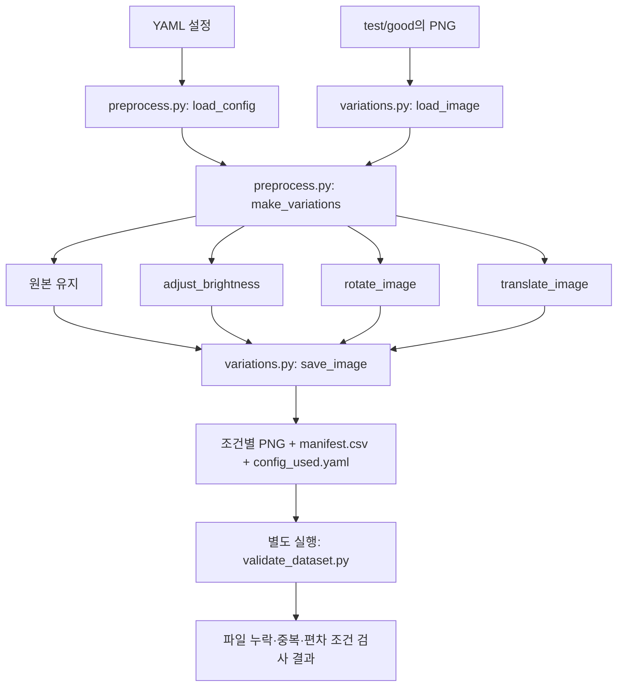
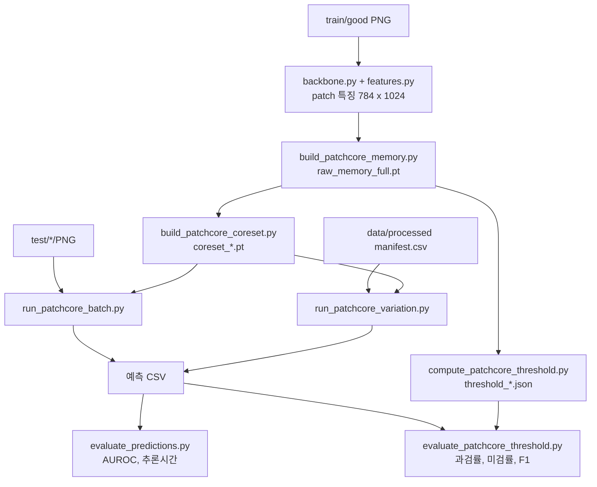

# 2026 학석박공동R&D 프로젝트

정상 편차를 고려한 산업 이미지 이상탐지 연구를 위한 협업 저장소입니다.

- [0. 서론](#0-서론)
- [1. 초기 설정](#1-초기-설정)
- [2. 프로젝트 구조와 아키텍처](#2-프로젝트-구조와-아키텍처)
- [3. 협업 규칙 및 주의사항](#3-협업-규칙-및-주의사항)
- [4. 문의](#4-문의)

## 0. 서론

안녕하세요. 이번 학석박 R&D 프로젝트에서 로즈마리팀의 팀장을 맡은 게임학과 3학년 김경건입니다.

저를 포함해 머신러닝/딥러닝 프로젝트가 익숙치 않은 팀원분도 함께 진행할 수 있도록 이 리드미를 작성했습니다. 초기 설정부터 프로젝트 전체 흐름, 역할별 코드 구조, 협업 등을 정리했습니다.

해당 레포는 각자의 코드를 같은 흐름으로 연결하기 위한 기본적인 틀 입니다. 각 담당자가 전처리, 모델구현, 평가를 추가하고 다른 팀원도 같은 조건과 명령으로 실험을 다시 실행할 수 있도록 만드는 것이 목적입니다.

이미 본인 환경에서 모델 구현을 진행하신 분은 그 코드를 이어서 사용하시면 됩니다. 저장소에 맞추려고 처음부터 다시 구현하지 말고 실행 방법과 필요한 설정만 정리해서 저희의 입출력에만 연결해주세요.

직접 리드미와 코드를 읽고 진행하셔도 되고, 본인이 사용하는 AI나 학교에서 지원하는 클로트 team에 리드미와 레포를 먹여 활용하셔도 됩니다. 단, 산업체 데이터를 다룰때는 조심해주세요.

모르는 내용이나 막히는 부분은 부담 없이 질문해 주세요. 이번 학기 잘 부탁드립니다!

## 1. 초기 설정

아래는 `Windows PowerShell`과 `Python 3.11` 기준입니다.

### 1-1. 준비 프로그램과 저장소 내려받기

[Git](https://git-scm.com/downloads)과 Python 3.11을 먼저 설치해 주세요.

프로젝트를 보관할 위치에서 PowerShell을 열고 실행합니다.

```powershell
git clone https://github.com/heparidayo/industrial-anomaly-research.git
Set-Location industrial-anomaly-research
py -3.11 --version
```

이후 명령은 모두 프로젝트 루트(requirements.txt가 있는 폴더)에서 실행합니다.

### 1-2. 가상환경 만들기

가상환경은 이 프로젝트에서 사용할 Python 패키지를 별도로 설치하는 공간입니다.

```powershell
py -3.11 -m venv .venv
```
만약, `py` 명령이 없다면 `python -m venv .venv`로 생성할 수 있습니다.

### 1-3. 패키지 설치

현재 공용 PatchCore 예시에서 사용하는 조합은 `torch 2.9.0`, `torchvision 0.24.0`입니다. 아래 GPU 혹은 CPU 중 하나만 선택하면됩니다.

- CUDA 12.8 빌드 (GPU)

```powershell
.\.venv\Scripts\python.exe -m pip install torch==2.9.0 torchvision==0.24.0 --index-url https://download.pytorch.org/whl/cu128
.\.venv\Scripts\python.exe -m pip install -r requirements.txt
```

- CPU 빌드 (GPU가 없다면..)

```powershell
.\.venv\Scripts\python.exe -m pip install torch==2.9.0 torchvision==0.24.0 --index-url https://download.pytorch.org/whl/cpu
.\.venv\Scripts\python.exe -m pip install -r requirements.txt
```
출처는 [PyTorch 공식 이전 버전 안내](https://pytorch.org/get-started/previous-versions/#v290)입니다. 

> 특히 모델 담당 분들은, 모델 구현에서 별도 버전이 필요하면 담당 모델의 의존성 파일과 설치 방법을 추가해주세요. 예를 들어 `requirements-draem.txt`처럼 분리할 수 있습니다. 혹시나 공용 패키지 버전을 바꿔야되는 경우 저 혹은 다른 모델 담당자 분들에게 미리 말씀주시면 좋겠습니다.

### 1-4. 로컬 폴더와 데이터 준비

데이터와 결과 폴더(`./data`, `./outputs`)은 github로 전달되지 않으므로 미리 준비해둔 코드로 생성해줍니다.

```powershell
New-Item -ItemType Directory -Force -Path data, outputs, experiments | Out-Null
```

공개 데이터는 [MVTec AD 공식 페이지](https://www.mvtec.com/research-teaching/datasets/mvtec-ad)의 다운로드 안내에 따라 받습니다. 사용 조건도 공식 페이지에서 확인해 주세요. 현재 공용 실행 예시는 `bottle`을 사용합니다.

```text
data/
└── raw/
    ├── mvtec_ad/
    │   └── bottle/
    │       ├── train/good/              # 정상 학습 이미지
    │       ├── test/good/               # 정상 테스트 이미지
    │       ├── test/<defect_type>/      # 불량 테스트 이미지
    │       └── ground_truth/<defect_type>/ # 결함 마스크
    └── company/                        # 산업체 제공 데이터
```

산업체 데이터는 저 혹은 저희 단톡으로 전달받고, 각 모델 담당자는 전달받은 데이터를 본인 모델의 입력 방식에 맞게 읽어 실험을 진행해 주세요.    
아래 실행 명령은 MVTec bottle 기준 예시입니다. 원본 파일은 유지하고, 학습/검증/테스트 분할은 팀 공통 기준(해당 레포 구조)를 사용합니다.


### 1-5. 설치 확인

폴더와 패키지 설정을 `check_setup.py` 코드로 확인합니다.

```powershell
.\.venv\Scripts\python.exe scripts/setup/check_setup.py
.\.venv\Scripts\python.exe -m pip check
.\.venv\Scripts\python.exe -c "import torch, torchvision, cv2, yaml, sklearn; print('패키지 확인 완료')"
```

bottle을 배치했다면 `inspect_dataset.py` 코드로 이미지 개수도 확인합니다.

```powershell
.\.venv\Scripts\python.exe scripts/preprocessing/inspect_dataset.py
```

NVIDIA GPU를 사용하는 분은 `check_torch.py` 코드로 다음 점검도 진행합니다. 이 코드는 GPU에서 실제 텐서 연산을 진행하고, CPU 환경에서는 CUDA를 사용할 수 없다고 오류가 잡히게 되어있습니다.

```powershell
.\.venv\Scripts\python.exe scripts/setup/check_torch.py
```

## 2. 프로젝트 구조와 아키텍처

먼저 폴더 역할 구분입니다.

- **`src/`**: 여러 실행 코드에서 재사용하는 함수와 모델을 구현합니다.
- **`scripts/`**: 명령을 받아 `src/`의 기능을 호출하는 진입점입니다.
- **`configs/`**: 밝기·회전 등 실험 조건을 YAML로 관리합니다.
- **`data/`**: 원본과 전처리 데이터를 로컬에 보관합니다.
- **`outputs/`**: 가중치, (patchCore 기준) Memory Bank, 예측 CSV, 평가 결과를 로컬에 저장합니다.

새로운 변환 함수나 모델 로직은 `src/`에 넣고, 실행 인자와 호출 순서는 `scripts/`, 바꿔 가며 비교할 조건은 `configs/`로 나눕니다.

```text
configs/experiments/      # 공용 실험 조건
scripts/
├── setup/               # 설치 및 환경 점검
├── preprocessing/       # 데이터 점검, 정상편차 생성/검증
├── patchcore/           # 현재 공용 PatchCore 예시 실행
└── evaluation/          # 예측 CSV 평가
src/
├── preprocessing/       # 이미지 변환 함수
├── models/patchcore/    # 현재 공용 PatchCore 예시 구현
└── evaluation/          # 지표 계산, 시각화
```

DRAEM과 EfficientAD 담당자는 구현을 연결하면서 `src/models/draem/`, `scripts/draem/` 및 `src/models/efficientad/`, `scripts/efficientad/`처럼 담당 폴더를 추가하면 됩니다. 위 모델의 폴더와 실행 코드는 아직 공용 저장소에 없습니다.

### 2-1. 전체 아키텍처

(제공된 자동차 정밀 부품 이미지에서 어떤 모델 + 전처리 조합이 정상과 불량을 잘 구분하며, 밝기/회전/위치 변화에도 안정적으로 동작하는가?)

### 2-2. 전처리 아키텍처

현재 전처리는 `test/good`의 정상 이미지에 밝기/회전/X축 이동을 각각 적용합니다. 예를 들어 밝기 `20`은 20% 증가, 회전 `5`는 5도, 이동 `6`은 원본 이미지에서 X축 6픽셀 이동입니다. 각 변형은 원본에서 개별 생성합니다.



파일 기준으로 읽으면 다음 순서입니다.

```text
configs/experiments/bottle_variation_v2.yaml
  → scripts/preprocessing/preprocess.py
  → src/preprocessing/variations.py의 이미지 읽기·변형·저장 함수
  → data/processed/bottle/bottle_variation_v2/
  → scripts/preprocessing/validate_dataset.py로 결과 검사
```

기존 전처리 실행 명령입니다.

```powershell
.\.venv\Scripts\python.exe scripts/preprocessing/preprocess.py --config configs/experiments/bottle_variation_v2.yaml
.\.venv\Scripts\python.exe scripts/preprocessing/validate_dataset.py data/processed/bottle/bottle_variation_v2/manifest.csv
```

생성되는 `manifest.csv`는 “어느 원본에서 어떤 변형을 만들었는지” 적어 둔 목록입니다. 현재 컬럼은 `image_id, source_image, label, variation, level`이며 라벨은 `normal` 문자열입니다. `config_used.yaml`은 생성에 사용한 설정의 사본입니다.

같은 실험 이름으로 다른 조건을 사용하면 충돌을 막기 위해 실행이 중단됩니다. 새로운 조건은 YAML의 `experiment.name`도 바꿔 주세요.

*TODO 아래 작성 필요*

### 2-3. 모델 아키텍처

모델 내부 구조와 학습 방식은 담당자가 사용하는 구현에 따라 달라집니다. 각 모델의 상세 아키텍처는 담당자가 자신의 실제 코드 기준으로 설명하고 이 문서에 추가해 주세요.

현재 공용 저장소의 PatchCore는 제가 실행 흐름을 확인하려고 만든 예제입니다. 별도로 진행 중인 PatchCore 담당자의 구현은 담당자 설명과 설정을 기준으로 연결합니다.

#### 2-3-1. 예시 모델 아키텍처
#### 2-3-2. PatchCore 아키텍처

PatchCore는 신경망을 새로 학습하지 않습니다. ImageNet으로 학습된 CNN에서 정상 이미지의 patch 특징을 뽑아 메모리 뱅크에 저장하고, 테스트 patch가 가장 가까운 정상 patch와 얼마나 먼지를 이상 점수로 사용합니다. 그래서 정상 데이터가 얼마나 다양한 모습을 담고 있는지가 성능을 좌우합니다.

| 항목 | 설정 | 코드 |
|---|---|---|
| Backbone | WideResNet50 (ImageNet `IMAGENET1K_V2`), `layer2` + `layer3` | `backbone.py` |
| 입력 전처리 | resize 232 → center crop 224, ImageNet 정규화 | `weights.transforms()` |
| Patch 특징 | 3x3 주변 묶음, layer3를 28x28로 맞춰 합친 뒤 1024차원, 이미지당 784개 | `features.py` |
| 메모리 뱅크 | 학습 정상(`train/good`) 전체 patch 특징 | `memory_bank.py` |
| Coreset | approximate greedy, 기본 1%, 128차원 투영, seed 0 | `coreset.py` |
| 이상 점수 | patch별 최근접 정상 patch까지 L2 거리, 이미지 점수 = 최댓값 | `scoring.py` |
| Anomaly map | 28x28 점수 → 224 업샘플 + Gaussian(σ=4) | `anomaly_map.py` |
| Threshold | 학습 정상을 그룹으로 나눠 돌아가며 빼고 채점한 점수의 최댓값 (테스트 정답 미사용) | `threshold.py` |



실행 순서입니다. `<category>`는 `data/raw/mvtec_ad/` 아래 폴더 이름입니다 (예: `bottle`, `company_cam1`).

```powershell
# 1. 정상 특징 수집 → coreset
.\.venv\Scripts\python.exe scripts/patchcore/build_patchcore_memory.py --category <category>
.\.venv\Scripts\python.exe scripts/patchcore/build_patchcore_coreset.py --input outputs/patchcore/<category>/raw_memory_full.pt --percentage 0.01

# 2. 테스트셋 추론 → AUROC, 추론시간
.\.venv\Scripts\python.exe scripts/patchcore/run_patchcore_batch.py --category <category> --memory outputs/patchcore/<category>/coreset_raw_memory_full_1pct_d128_s0.pt
.\.venv\Scripts\python.exe scripts/evaluation/evaluate_predictions.py --csv outputs/predictions/patchcore/<category>_original.csv

# 3. threshold → 과검률, 미검률, F1
.\.venv\Scripts\python.exe scripts/patchcore/compute_patchcore_threshold.py --category <category>
.\.venv\Scripts\python.exe scripts/patchcore/evaluate_patchcore_threshold.py --csv outputs/predictions/patchcore/<category>_original.csv --threshold outputs/patchcore/<category>/threshold_1pct_d128_s0_k10.json

# 4. 정상편차 이미지 추론 (preprocess.py로 만든 manifest 사용)
.\.venv\Scripts\python.exe scripts/patchcore/run_patchcore_variation.py --manifest data/processed/<category>/<실험이름>/manifest.csv --memory outputs/patchcore/<category>/coreset_raw_memory_full_1pct_d128_s0.pt
.\.venv\Scripts\python.exe scripts/patchcore/evaluate_patchcore_threshold.py --csv outputs/predictions/patchcore/<category>_<실험이름>.csv --threshold outputs/patchcore/<category>/threshold_1pct_d128_s0_k10.json --defects-csv outputs/predictions/patchcore/<category>_original.csv

# (선택) 여러 카테고리 × coreset 비율 일괄 실행 → outputs/patchcore/summary/<요약이름>.csv(계산용) + .md(보기용 표)
.\.venv\Scripts\python.exe scripts/patchcore/run_patchcore_experiment.py --name <요약이름> --categories <category> ... --pcts 0.01 0.1 0.25

# (선택) 결과 그래프 — 추가 의존성: pip install -r requirements-patchcore.txt
.\.venv\Scripts\python.exe scripts/patchcore/plot_patchcore_results.py
```

입출력 규칙입니다.

- 예측 CSV 컬럼: `image_id, label(0 정상/1 불량), defect_type, variation, level, anomaly_score, inference_ms`. 정상편차 CSV도 같은 형식입니다.
- 결과 파일명에 설정이 들어갑니다 (예: `coreset_raw_memory_full_1pct_d128_s0.pt`, `threshold_1pct_d128_s0_k10.json`). 모든 스크립트는 기존 결과를 덮어쓰지 않고 멈추므로, 설정을 바꿔 다시 돌릴 때는 `--output`으로 다른 이름을 주세요.
- threshold는 실제 추론에 쓰는 coreset과 같은 비율·투영 차원·seed로 계산해야 합니다.
- 과검률/미검률/F1 계산 함수(`src/evaluation/threshold_metrics.py`)는 예측 CSV만 있으면 되므로 DRAEM, EfficientAD 결과에도 그대로 쓸 수 있습니다. 모델 간 비교를 위해 같은 threshold 규칙(학습 정상 held-out 최댓값)을 쓰는 것을 제안합니다.
- 불량이 정상보다 훨씬 많은 데이터에서는 "전부 불량" 판정에서도 F1이 높게 나옵니다. F1은 과검률·미검률과 함께 보고해 주세요.

산업체 데이터 적용 방법입니다.

원본은 `data/raw/company/`에 그대로 두고(수정 금지), 아래 스크립트로 MVTec 형식 카테고리를 만들어 위 명령을 그대로 사용합니다. 카테고리는 3-1의 기준대로 카메라 1, 카메라 2, 카메라 1+2 세 가지입니다.

```powershell
# company_cam1 / company_cam2 / company_cam12 생성 (카메라별 정상 10장 학습, 나머지 테스트, seed 0)
.\.venv\Scripts\python.exe scripts/preprocessing/prepare_company_dataset.py

# 부품 영역만 자른 버전 (company_*_roi), 다른 분할 (company_*_s1 ...)
.\.venv\Scripts\python.exe scripts/preprocessing/prepare_company_dataset.py --roi
.\.venv\Scripts\python.exe scripts/preprocessing/prepare_company_dataset.py --seed 1

# 부품만 회전한 정상편차 (이미지 전체 회전은 모서리 인공물로 과검이 과장될 수 있음)
.\.venv\Scripts\python.exe scripts/preprocessing/preprocess_part_rotation.py --config configs/experiments/company_cam1_roi_partrot_v1.yaml
.\.venv\Scripts\python.exe scripts/preprocessing/validate_dataset.py data/processed/company_cam1_roi/company_cam1_roi_partrot_v1/manifest.csv
```

- 각 카테고리의 `split.csv`에 어떤 이미지가 학습/테스트인지 기록됩니다. 다른 모델도 같은 `split.csv`를 쓰면 같은 조건으로 비교할 수 있습니다.
- ROI는 라벨의 기준 원(class 1) 위치로 카메라별 고정 박스 하나를 정해 자릅니다 (`dataset_info.json`에 기록). 이미지마다 라벨로 자르지 않습니다.
- 라벨은 결함 마스크가 아니라 부품 윤곽선이므로 pixel 단위 평가는 하지 않고, 이미지 단위(폴더 이름 = 정답)로 평가합니다.
- 회사 데이터, 결과 이미지, 결과 수치는 `data/`, `outputs/`에만 두고 저장소에 올리지 않습니다.
#### 2-3-3. AfficientAD 아키텍처
#### 2-3-4. DRAEM 아키텍처


### 2-4. 평가 아키텍처

(작성 예정)

## 3. 협업 규칙 및 주의사항

(작성 예정)

### 3-1. 데이터 

(작성 예정)

- 카메라 1
- 카메라 2
- 카메라 1 + 2
- 
### 3-2. Git에 올리는 것 vs 올리면 안되는 것

(작성 예정)

- 공유할거 
- 공유안할거

## 4. 문의

설정 오류, 코드 연결 등등 궁금한 점은 단톡방이나 따로 알려드린 개인 연락처로 편하게 연락해 주세요. 카톡, 전화, 디코 어느 쪽이든 괜찮습니다.
