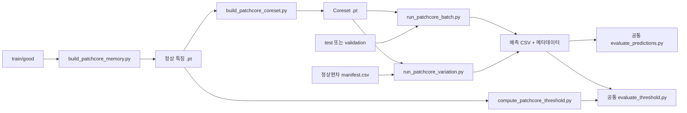

# PatchCore 실험 안내

이 문서는 팀 초안의 자체 구현 PatchCore를 재사용하는 **프로토타입 실험 파이프라인**을 설명합니다.
논문·저자 구현과 같은 성능을 재현했다고 검증된 모델은 아닙니다. 공식 모델 도입과 비교 검증은 별도 작업입니다.
PR #1의 실험 기능을 정리했으며, 공통 데이터 분할·ROI·평가 규칙은 각 담당자 검토 후 확정합니다.

## 구현과 입출력

- Backbone: WideResNet50-2, ImageNet V2 가중치, layer2·layer3.
- 모델 입력: resize 232, center crop 224, ImageNet 정규화.
- 특징: 3×3 주변 특징을 결합한 1024차원 벡터 784개.
- Memory Bank: 정상 학습 이미지만 사용하고 Coreset으로 대표 특징을 선택합니다.
- 점수: Patch별 최근접 정상 특징까지의 L2 거리, 이미지 점수는 최댓값.
- 임계값: 정상 학습 촬영그룹을 번갈아 제외해 얻은 점수의 최댓값. 이 보정법은 현재 프로토타입의 실험 규칙입니다.
- CSV: 기존 공통 컬럼을 유지합니다. 회사 데이터에는 camera·group_id, 편차에는 source_image를 추가할 수 있습니다.
- CSV 옆의 .meta.json: 사용 Memory Bank, 입력 목록의 변경 정보, 실행 장치·환경을 기록합니다.

저자 구현과의 설정 차이는 논문 비교 전에 점검해야 합니다.
공식 기본 실행 예시는 resize 256과 crop 224를 사용합니다.
출처: [PatchCore 논문](https://arxiv.org/abs/2106.08265), [저자 코드](https://github.com/amazon-science/patchcore-inspection).

## 코드 흐름



재사용하는 추론 루프는 src/models/patchcore/batch.py에 있습니다.
임계값 보정은 src/models/patchcore/threshold.py, 고정 임계값 지표는 src/evaluation/threshold_metrics.py에 분리했습니다.
scripts/patchcore/evaluate_patchcore_threshold.py는 기존 PR 명령을 유지하는 공통 평가기의 호환 진입점입니다.

## 기존 bottle 예시

아래 명령은 결과 파일이 없는 환경에서 프로젝트 루트 기준으로 실행합니다.
설치는 [프로젝트 README](../../../README.md)를 참고하세요.

```powershell
.\.venv\Scripts\python.exe scripts/patchcore/build_patchcore_memory.py --category bottle
.\.venv\Scripts\python.exe scripts/patchcore/build_patchcore_coreset.py --input outputs/patchcore/bottle/raw_memory_full.pt --percentage 0.01
.\.venv\Scripts\python.exe scripts/patchcore/run_patchcore_batch.py --category bottle --memory outputs/patchcore/bottle/coreset_raw_memory_full_1pct_d128_s0.pt
.\.venv\Scripts\python.exe scripts/evaluation/evaluate_predictions.py --csv outputs/predictions/patchcore/bottle_original.csv
```

임계값 평가를 추가할 때는 **추론에 쓴 Coreset과 같은 비율·투영 차원·시드**를 사용합니다.

```powershell
.\.venv\Scripts\python.exe scripts/patchcore/compute_patchcore_threshold.py --category bottle
.\.venv\Scripts\python.exe scripts/evaluation/evaluate_threshold.py --csv outputs/predictions/patchcore/bottle_original.csv --threshold outputs/patchcore/bottle/threshold_1pct_d128_s0_k10.json --category bottle
```

실제 fold 수는 요청한 수와 정상 촬영그룹 수 중 작은 값입니다.
예를 들어 그룹이 5개면 결과 이름은 k5입니다. 출력된 파일명을 확인하세요.
기존 산출물은 자동으로 덮어쓰지 않습니다. 이전 버전 산출물에 출처 메타데이터가 없으면 일괄 실행에서 재사용을 거부합니다.

## 산업체 데이터 준비

전처리는 모델에 종속되지 않는 공통 기능입니다.
실행은 scripts/preprocessing/company/, 구현은 src/preprocessing/company/에 있습니다.
회사 원본을 data/raw/company/에 두며, 그 안에 정상/가 있는 폴더가 하나 더 있어도 자동으로 찾습니다.

```powershell
.\.venv\Scripts\python.exe scripts/preprocessing/company/prepare_dataset.py --config configs/datasets/company_v1.yaml
.\.venv\Scripts\python.exe scripts/preprocessing/company/prepare_dataset.py --config configs/datasets/company_v1.yaml --roi
```

출력은 data/processed/company/company_cam1, company_cam2, company_cam12이며, ROI는 _roi 접미사가 붙습니다.
원본 이미지와 라벨은 수정하지 않습니다.

현재 설정은 **제안값**입니다. 카메라당 정상 10장 학습·3장 검증·나머지 테스트를 사용하며 seed는 0입니다.
두 카메라의 같은 촬영번호를 하나의 그룹으로 묶습니다.
학습 정상 뷰와 같은 촬영번호인 불량 뷰는 unused로 기록하고 검증·테스트에서 제외합니다.
각 카테고리의 split.csv와 dataset_info.json을 확인한 뒤 팀 공통 조건으로 확정하세요.

고정 ROI는 **학습 정상 이미지의 기준 원 라벨만**으로 보정합니다.
개별 테스트 라벨로 ROI를 정하거나 테스트 라벨 전체를 평균내지 않습니다.
ROI 박스가 이미지 밖으로 나가거나 필요한 라벨이 없으면 중단합니다.
입력 라벨 좌표의 기준 크기는 설정에 명시해야 합니다.

## 회사 데이터 일괄 실행

일괄 실행은 모델 실행을 묶고 **기존 공통 AUROC 평가기와 공통 고정 임계값 평가기**를 호출합니다.
별도의 모델이나 대체 AUROC 평가기를 구현하는 스크립트가 아닙니다.

먼저 검증셋에서 조건을 비교합니다.

```powershell
.\.venv\Scripts\python.exe scripts/patchcore/run_patchcore_experiment.py --name company_validation_v1 --categories company_cam1 company_cam2 company_cam12 --data-root data/processed/company --split validation --pcts 0.01 0.1
.\.venv\Scripts\python.exe scripts/patchcore/run_patchcore_experiment.py --name company_roi_validation_v1 --categories company_cam1_roi company_cam2_roi company_cam12_roi --data-root data/processed/company --split validation --pcts 0.01
```

--plan-only를 추가하면 입력·설정만 확인하며 모델을 실행하지 않습니다.
중단된 동일 조건은 --resume으로 재개합니다. 이름이 같아도 입력·설정·코드가 다르면 재개를 거부합니다.
요약은 outputs/patchcore/summary/에 CSV·Markdown·실행 설정 JSON으로 저장합니다.
일괄 실행의 임계값 평가 JSON은 _threshold_k<실제 fold 수>_metrics.json으로 구분합니다.
같은 촬영번호 분할과 같은 입력 이미지를 다른 모델에도 적용할 수 있습니다.

검증 후 모델 설정·임계값을 고정하고 최종 테스트를 실행합니다.
아래 1%는 명령 형식의 예시이며 최적 조건이라는 뜻은 아닙니다.

```powershell
.\.venv\Scripts\python.exe scripts/patchcore/run_patchcore_experiment.py --name company_test_v1 --categories company_cam1 company_cam2 company_cam12 --data-root data/processed/company --split test --pcts 0.01
```

## 정상편차 생성과 추론

configs/experiments/company/의 YAML은 **모델 공통 편차 조건의 초안**입니다.
PatchCore 전용으로 확정된 연구 조건이 아닙니다. 큰 회전 각도는 스트레스 시험으로 구분하고 실제 정상 허용 범위는 팀에서 정합니다.

```powershell
.\.venv\Scripts\python.exe scripts/preprocessing/preprocess.py --config configs/experiments/company/company_cam1_roi_variation_v1.yaml
.\.venv\Scripts\python.exe scripts/preprocessing/company/preprocess_part_rotation.py --config configs/experiments/company/company_cam1_roi_partrot_v1.yaml
.\.venv\Scripts\python.exe scripts/preprocessing/validate_dataset.py data/processed/company_variations/company_cam1_roi/company_cam1_roi_partrot_v1/manifest.csv
.\.venv\Scripts\python.exe scripts/patchcore/run_patchcore_variation.py --manifest data/processed/company_variations/company_cam1_roi/company_cam1_roi_partrot_v1/manifest.csv --memory outputs/patchcore/company_cam1_roi/coreset_raw_memory_full_1pct_d128_s0.pt
.\.venv\Scripts\python.exe scripts/evaluation/evaluate_threshold.py --csv outputs/predictions/patchcore/company_cam1_roi_company_cam1_roi_partrot_v1.csv --threshold outputs/patchcore/company_cam1_roi/threshold_1pct_d128_s0_k10.json --category company_cam1_roi
```

부품 회전은 라벨의 원 영역을 이용해 만드는 **제어된 합성 편차**입니다.
실제 부품의 촬영 변동과 같다고 검증된 변환은 아닙니다.
여기서 테스트 이미지의 원 라벨은 합성 편차 생성에만 쓰며, 추론 시 ROI 추정이나 모델 점수 계산에 전달하지 않습니다.

정상편차만 평가하면 과검률을 계산하고 미검률·F1·AUROC는 계산하지 않습니다.
--defects-csv로 같은 모델·설정의 원본 불량 예측을 붙일 수 있습니다.
이때 미검률은 원본 불량의 결과이며, 변형된 불량에 대한 성능 변화가 아닙니다.
판정은 anomaly_score > threshold이면 불량입니다. 같은 점수는 정상입니다.
테스트 정답으로 threshold를 최적화하는 참고 지표는 제공하지 않습니다.

## 그래프와 실행 환경

그래프에 필요한 선택 의존성만 따로 설치합니다.

```powershell
.\.venv\Scripts\python.exe -m pip install -r requirements-patchcore.txt
.\.venv\Scripts\python.exe scripts/patchcore/plot_patchcore_results.py --summary outputs/patchcore/summary/company_validation_v1.csv
.\.venv\Scripts\python.exe scripts/patchcore/plot_patchcore_results.py --threshold-metrics outputs/predictions/patchcore/company_cam1_roi_company_cam1_roi_partrot_v1_threshold_metrics.json
```

그래프는 입력 결과의 값만 사용하며 특정 수치나 실패 원인을 고정해서 설명하지 않습니다.
개인 장비의 속도는 중간 확인용입니다. 최종 속도 비교는 같은 PC·GPU·실행 조건에서 추론 자체를 다시 실행해야 합니다.
시간에는 이미지 읽기·입력 변환·특징 추출·점수 계산을 포함하고 모델 초기화·워밍업·CSV 저장은 제외합니다.
현재 코드에는 공통 GPU 벤치마크 자동화와 GPU 최대 메모리 측정이 포함되지 않습니다.

회사 이미지·라벨·가중치·Memory Bank·결과는 Git에 올리지 않습니다.
